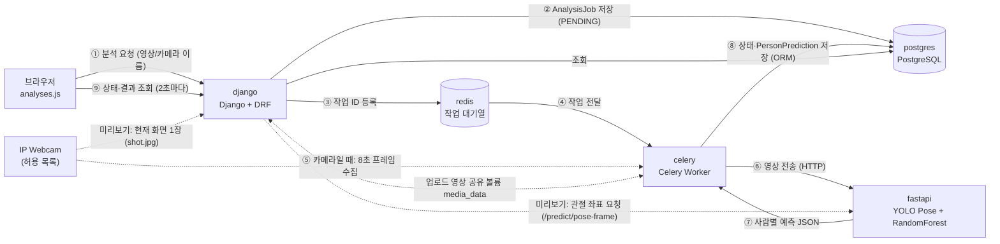
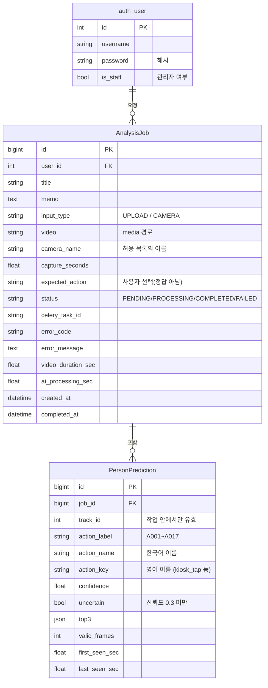
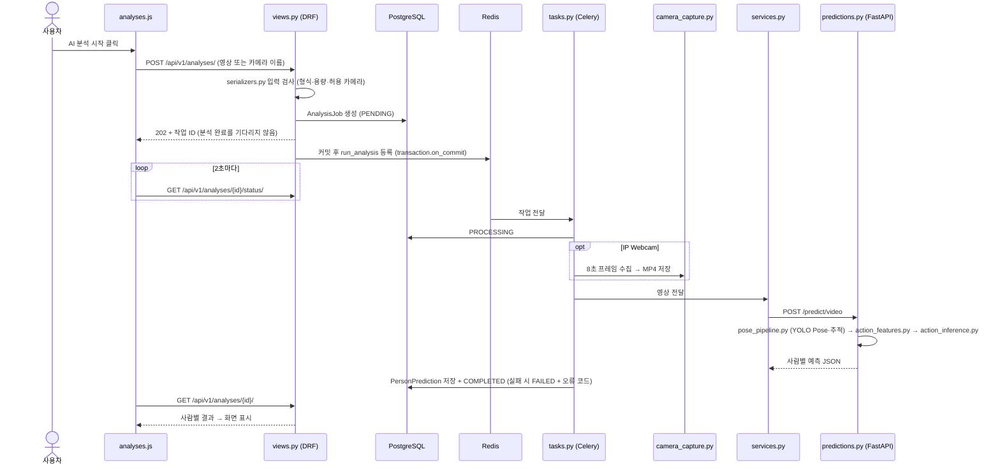

# Vision Action Platform

## 1. 프로젝트 소개

**무인 매장 CCTV 영상에서 이상행동을 찾아내는 서비스**입니다. 매장 영상을 올리거나 IP Webcam(CCTV 역할)으로 몇 초간 촬영하면, AI가 화면 속 사람마다 **17개 행동(기물 파손·폭력, 매장 내 부적절한 체류, 응급 상황) 중 어떤 행동인지**와 신뢰도를 알려 줍니다.
분석은 백그라운드에서 처리되므로 사용자는 기다리지 않고 진행 상태를 볼 수 있습니다. 결과는 PostgreSQL에 저장되고, 관리자는 대시보드에서 전체 통계를 확인합니다.

- 입력: 영상 업로드(MP4·MOV·AVI·MKV, 최대 100MB·60초), IP Webcam(허용된 카메라, 3~15초 수집, 기본 8초)
- IP Webcam 탭에서는 카메라 화면을 미리 볼 수 있고, **관절(스켈레톤)을 실시간으로 겹쳐 표시**합니다. Django가 허용된 카메라의 `/shot.jpg`를 대신 받아(`/cameras/<이름>/pose.json`, 로그인 필요) FastAPI `POST /predict/pose-frame`(YOLO Pose, 관절 좌표만)에 보내고, 사진과 관절 좌표를 함께 브라우저에 돌려줍니다. 브라우저에는 카메라 주소가 드러나지 않습니다. 영상 분석 중에는 분석이 느려지지 않도록 관절 표시를 잠시 멈춥니다. 미리보기는 분석에 쓰지 않습니다.
- 결과: 사람(Track ID)별 예측 동작, 신뢰도, 판단 불확실 표시, 후보 Top 3, 처리 시간

## 2. 실행 방법

준비물: Docker Desktop(또는 Docker Engine + Compose v2)

```bash
git clone https://github.com/Hu250506/test20261124-motion_capture.git
cd test20261124-motion_capture
cp .env.example .env          # 비밀번호·SECRET_KEY를 바꾸고, 카메라를 쓸 경우 ALLOWED_CAMERAS 입력
docker compose up --build -d  # 처음 빌드는 PyTorch 설치 때문에 수 분 걸립니다
docker compose exec django python manage.py createsuperuser   # 관리자 계정 만들기
```

- 모델 파일은 저장소에 들어 있습니다: `ai_service/models/action17/`, `ai_service/models/yolo11n-pose.pt`
- DB 마이그레이션은 `django` 컨테이너가 시작될 때 자동으로 적용됩니다(`python manage.py migrate`).

| 화면 | 주소 |
|---|---|
| 회원가입 / 로그인 | http://localhost:8000/accounts/signup/ · http://localhost:8000/accounts/login/ |
| 사용자 분석 화면 | http://localhost:8000/analyses/ |
| 관리자 대시보드 (관리자만) | http://localhost:8000/dashboard/ |
| Django Admin | http://localhost:8000/admin/ |
| 분석 API (DRF) | http://localhost:8000/api/v1/analyses/ |
| FastAPI Swagger (개발용) | http://localhost:8001/docs |

종료: `docker compose down` (데이터 유지) · 데이터까지 삭제: `docker compose down -v`

## 3. 전체 아키텍처

`compose.yaml`이 실행하는 서비스는 **postgres · redis · fastapi · django · celery 5개**입니다.



- **FastAPI**는 추론만 하고 DB에 접근하지 않습니다. 결과 저장은 Celery Worker가 Django ORM으로 합니다.
- 점선 중 '미리보기' 두 줄은 IP Webcam 탭의 실시간 화면·스켈레톤 표시용입니다. 결과를 저장하지 않으며, 분석에는 ⑤에서 수집한 영상만 씁니다.
- 컨테이너끼리는 `localhost`가 아니라 서비스 이름(`postgres`, `redis`, `fastapi`)으로 접속합니다.

## 4. DB 설계 (ERD)

직접 작성한 모델은 `backend/analyses/models.py`에 있습니다. 회원은 Django 기본 `auth_user`를 그대로 씁니다.



- `auth_user`: 회원 계정과 관리자 여부
- `AnalysisJob`: 분석 요청 1건과 진행 상태·오류·처리 시간. 영상 파일은 DB가 아닌 media 폴더에 저장
- `PersonPrediction`: 한 작업 안에서 추적한 사람별 예측. 영상에 2명이 나오면 작업 1건에 2행

## 5. AI 분석 버튼 구현 흐름



## 6. 사용한 모델과 입력 형식

- **Pose**: `yolo11n-pose.pt` (COCO 17 관절). 약 30fps로 샘플링하고 ByteTrack으로 사람별 추적
- **동작 분류**: `ai_service/models/action17/action17_rf.joblib`. RandomForest 트리 300개, 17개 동작, 입력 1,543개
  - 6일차 38-D(정규화 좌표 34 + 팔꿈치·무릎 각도 4)에 고관절·어깨 각도, 상체 기울기, 몸 높이를 더해 프레임당 44개
  - 이를 30 Step 시퀀스(1,320)로 만들고, 영상 전체 요약 통계(220)와 골반 이동량(3)을 붙임
  - Feature 계산 코드 `ai_service/services/action_features.py`를 학습과 추론이 함께 씀
- **학습·평가**: 5명 × 17동작 × 최대 3방향, 영상 238개. 사람 단위 교차검증(Leave-One-Subject-Out)으로 정확도 **0.782**, Macro F1 **0.777** (자세한 내용은 [`training/README.md`](training/README.md))
- **FastAPI 입출력**: `POST /predict/video`에 영상 파일을 보내면 `persons[]`에 `track_id`, `action_label`, `action_name`, `action_key`, `confidence`, `uncertain`, `top3`, `valid_frames`를 담아 돌려줌. 처리할 수 없으면 오류 코드를 돌려줌: `no_person_detected`, `video_too_short`, `video_open_failed`, `insufficient_sequence`
- **행동 목록**: 한국어 이름은 `ai_service/models/action17/action_labels.json`과 `backend/analyses/models.py`의 `ACTION_NAMES`, 영어 이름은 `action_keys.json`과 `ACTION_KEYS`에 있습니다. 두 쌍이 같은지는 테스트(`ActionLabelTests`)가 검사합니다. 모델은 번호(`A001`~`A017`)로 학습했으므로 이름만 바꿀 때는 다시 학습하지 않아도 됩니다.

| ID | 행동 | 영어 이름(`action_key`) |
|---|---|---|
| A001 | 키오스크 두드리기 | `kiosk_tap` |
| A002 | 한손 물건 던지기 | `throw_one_hand` |
| A003 | 앞차기 | `front_kick` |
| A004 | 잡고 흔들기 | `grab_shake` |
| A005 | 밀치기 | `push` |
| A006 | 휘두르기 | `swing` |
| A007 | 바닥에 앉기 | `sit_floor` |
| A008 | 위에 앉기 | `sit_on_object` |
| A009 | 앞으로 눕기 | `lie_forward` |
| A010 | 뒤로 눕기 | `lie_backward` |
| A011 | 몸통 박치기 | `body_slam` |
| A012 | 쪼그려 물건 빼내기 | `crouch_take_item` |
| A013 | 샷건 | `shotgun` |
| A014 | 구토 | `vomit` |
| A015 | 옆으로 쓰러지기 | `fall_sideways` |
| A016 | 뒤로 넘어지기 | `fall_backward` |
| A017 | 앞으로 넘어지기 | `fall_forward` |

> 모델은 학습한 17개 행동 중 하나로만 답합니다. 정상적인 손님 행동도 그중 하나로 나올 수 있으므로, 예측을 곧바로 이상행동 확정으로 보지 않고 신뢰도와 영상을 함께 확인하는 **검토 대상 알림**으로 씁니다. 학습에 참여한 사람이 5명뿐이라 새로운 사람·환경에서는 정확도가 낮을 수 있습니다.

## 7. 실행 결과와 검증

| 테스트 | 입력 | 결과 |
|---|---|---|
| T01 모델 불러오기 | `/health` | 17개 Class, Feature 1,543개 확인 |
| T02 영상 업로드 | S05_A009_T02.mp4 (11초) | 202 응답(0.4초) → PROCESSING → COMPLETED, A009 (0.70) |
| T03 IP Webcam | 가짜 MJPEG 카메라(A001 영상 반복), 4초 수집 | COMPLETED, A001 (0.29, 판단 불확실) |
| T03-2 실제 휴대폰 | IP Webcam 앱(같은 와이파이), 8초 수집, 앞차기 수행 | COMPLETED, 1순위 A003 앞차기(정답). 몸이 화면 밖으로 나가면 한 사람이 Track 여러 개로 나뉨 → 전신이 보이게 촬영 |
| T04 사람별 결과 | 두 사람을 나란히 붙인 영상 | 작업 1건에 Track 1·2 두 행 저장 |
| T05 비동기 | 업로드 직후 | 웹 서버가 작업 ID를 바로 반환, 처리는 Worker가 함 |
| T06 영구 저장 | `docker compose down` → `up` | 작업·예측·영상 그대로 남음 |
| T07 CRUD 권한 | 회원 A·B | B가 A의 작업에 GET·PATCH·DELETE → 404, 상태 값은 PATCH로 바꿀 수 없음 |
| T08 관리자 | admin 계정 | 전체 작업 목록, 동작별 막대·상태별 원형 차트 |
| T09 예외 처리 | `.txt` 파일, 허용 안 된 카메라, 깨진 MP4, FastAPI 중단 | 400 / 400 / FAILED `video_open_failed` / 10초 간격 3번 재시도 후 FAILED `ai_unreachable` |
| T10 Docker | 5개 서비스 재시작 | PostgreSQL 데이터 유지, 서비스 재연결 |
| T11 Docker 빌드 | `docker compose up --build -d` (Windows + WSL, Docker Desktop) | 5개 서비스 healthy/running, PyTorch `2.15.0+cpu`(download.pytorch.org) |
| T12 미리보기·스켈레톤 | IP Webcam 탭 | 한 장에 약 0.18초(관절 검출 약 26ms). 영상 분석 중에는 관절 표시를 멈췄다가 끝나면 다시 표시. 페이지에 카메라 주소 없음 |
| T13 동작 이름 변경 | 이름 표 변경(번호는 그대로) | 저장된 예측도 새 이름·영어 이름으로 바뀜(마이그레이션 0003), 재학습 없음 |

자동 테스트: `docker compose exec django python manage.py test` (28개. 저장소의 `ai_service` 파일과 이름을 비교하는 2개는 backend 컨테이너 안에서는 건너뜀)

## 폴더 구조

```text
backend/      Django·DRF·Celery (accounts, analyses, templates, static)
ai_service/   FastAPI 추론 서비스 (routers, services, src, models)
training/     관절 추출·재학습 스크립트와 평가 결과
data/         학습용 축소 영상(videos_small)과 관절 데이터(keypoints)
compose.yaml  5개 서비스 정의
```
